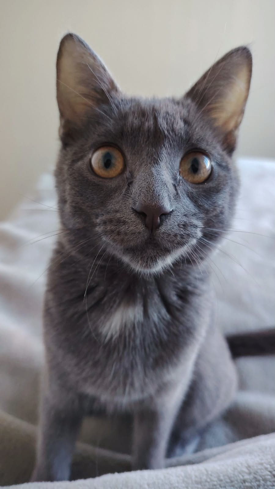

# Nora — Fotografía Felina de Autor & Boutique de Arte

> **Proyecto de Evaluación Parcial 02:** MKA1203 Sitios Web y Landing Pages  
> **Estudiante / Emprendimiento:** Nora — Fotografía Felina  
> **Tema:** Fotografía profesional de autor inspirada en la gata Nora, sesiones especializadas de retrato felino y tienda de láminas Fine Art.

---

## 🐾 Portada del Proyecto

**Nora Fotografía Felina** es un estudio boutique de fotografía artística y tienda de arte felino. Combina sesiones fotográficas en estudio y a domicilio con un enfoque de bienestar libre de estrés (*fear-free*) para gatos, junto con una galería de impresiones fotográficas Fine Art y photobooks conmemorativos inspirados en la gata **Nora**.

---

## 📑 Estructura de Documentación

Toda la documentación técnica y de diseño del proyecto se encuentra organizada en las siguientes fases:

### Fase 1: Definición de Requerimientos
- [x] [01-brief.md](file:///d:/Caro_Trabajos/Mi%20emprendimiento/docs/01-brief.md) — Brief del negocio, propuesta de valor y referentes.
- [x] [02-proto-personas.md](file:///d:/Caro_Trabajos/Mi%20emprendimiento/docs/02-proto-personas.md) — Proto-personas (Valentina y Diego), comportamientos, motivaciones y frustraciones.
- [x] [03-funcionalidades.md](file:///d:/Caro_Trabajos/Mi%20emprendimiento/docs/03-funcionalidades.md) — 7 funcionalidades base + 6 funcionalidades propias priorizadas.
- [x] [04-tecnologias.md](file:///d:/Caro_Trabajos/Mi%20emprendimiento/docs/04-tecnologias.md) — Stack tecnológico, matriz funcional vs. prototipo e integraciones.
- [x] [05-arquitectura.md](file:///d:/Caro_Trabajos/Mi%20emprendimiento/docs/05-arquitectura.md) — Mapa de sitio, 2 user flows detallados y taxonomía de categorías.

### Fase 2: Construcción de Specs
- [x] [Tablero Whimsical Oficial](https://whimsical.com/caroline6/ev-2-12-10-2026-RxoBc4RbXSZU6zmyAwKh61) — Moodboard, calco de componentes UI y wireframes de las 6 pantallas.
- [x] [DESIGN.md](file:///d:/Caro_Trabajos/Mi%20emprendimiento/DESIGN.md) — Design System completo en formato estándar con tokens, componentes y reglas.
- [x] [06-moodboard.md](file:///d:/Caro_Trabajos/Mi%20emprendimiento/docs/06-moodboard.md) — Moodboard conceptual, palabras clave y universo visual.
- [x] [07-componentes.md](file:///d:/Caro_Trabajos/Mi%20emprendimiento/docs/07-componentes.md) — Calco de componentes UI y justificación UX.
- [x] [08-color-tipografia.md](file:///d:/Caro_Trabajos/Mi%20emprendimiento/docs/08-color-tipografia.md) — Paleta de color, verificación de contraste WCAG AA/AAA y escala tipográfica.
- [x] [09-spec-diseno.md](file:///d:/Caro_Trabajos/Mi%20emprendimiento/docs/09-spec-diseno.md) — Prompts detallados para Google Stitch (Desktop y Mobile).
- [x] [10-spec-desarrollo.md](file:///d:/Caro_Trabajos/Mi%20emprendimiento/docs/10-spec-desarrollo.md) — Especificación de desarrollo web, arquitectura CSS, variables y criterios de aceptación.

### Fase 3: Prototipo y Aseguramiento de Calidad (QA)
- [x] [11-qa.md](file:///d:/Caro_Trabajos/Mi%20emprendimiento/docs/11-qa.md) — Matriz de verificación Spec vs. Prototipo, recorrido de User Flows y coherencia global.

---

## 🤖 Declaración de Uso de Inteligencia Artificial

En cumplimiento con las normas éticas y de evaluación de la asignatura:

1. **Herramientas utilizadas:**
   - **Google Antigravity / Gemini 3.7 Flash:** Empleado como asistente de ideación de requerimientos, estructuración de especificaciones técnicas (Spec-Driven Design), generación de las directrices del design system (`DESIGN.md`) y asistencia en la codificación de la web interactiva en HTML5, CSS3 y JavaScript.
   - **Google Imagen / Generación de Arte:** Empleado para la generación fotográfica realista y artística de la gata musa Nora, cuadros Fine Art, libros conmemorativos y avatares de proto-persona.
2. **Criterio y toma de decisiones:**
   - Todas las decisiones de negocio, definición del tono de voz cálido y artístico, selección de paleta inspirada en pelajes felinos y maderas naturales, y la priorización de funcionalidades orientadas a la reducción del estrés felino fueron tomadas y supervisadas directamente por el autor/estudiante.

---

## 💻 Vista Previa de la Aplicación Web

La aplicación web se encuentra implementada en los archivos raíz:
- [`index.html`](file:///d:/Caro_Trabajos/Mi%20emprendimiento/index.html)
- [`styles.css`](file:///d:/Caro_Trabajos/Mi%20emprendimiento/styles.css)
- [`app.js`](file:///d:/Caro_Trabajos/Mi%20emprendimiento/app.js)

Para visualizarla localmente, basta con abrir `index.html` en cualquier navegador web moderno o servirla mediante GitHub Pages.
