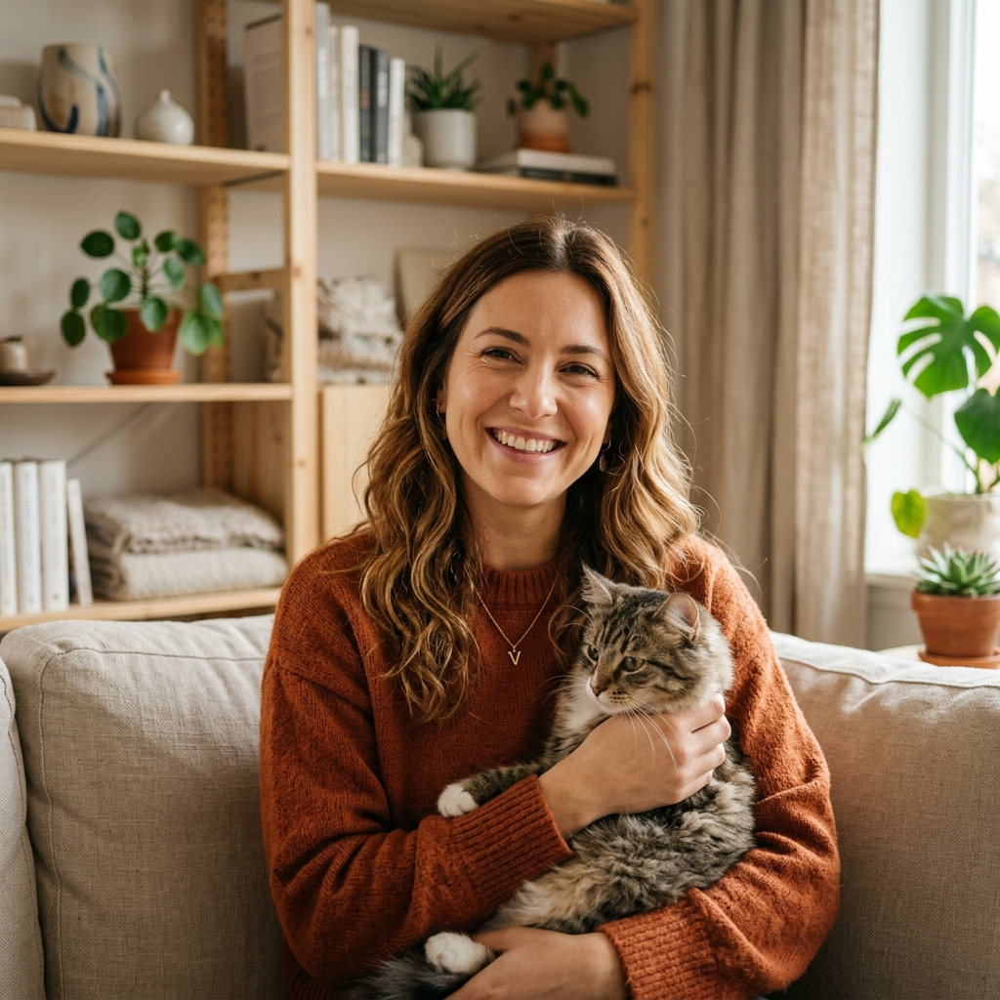

# Proto-personas — Nora — Fotografía Felina

> Guía: [Proto-persona](../evaluacion/guias/fase-1-requerimientos/02-proto-persona.md)

## Proto-persona principal

**Valentina Ramos, 29 años.** Diseñadora de Interiores y creadora de contenido. Vive en departamento con sus dos gatos rescatados, Simón y Olivia.

> *"Mis gatos son mi familia y quiero tener un recuerdo artístico de ellos que encaje con la estética de mi hogar, pero me aterra llevarlos a un estudio ruidoso donde sufran o se asusten."*

### Comportamientos
- Navega principalmente desde su teléfono móvil (iPhone) por las tardes y noches mientras descansa en el sofá, o desde su laptop MacBook en horario laboral.
- Es muy visual: consume contenido en Pinterest e Instagram sobre decoración nórdica, plantas de interior y fotografía pet-friendly.
- Valora la compra local, los materiales sostenibles y las marcas con propósito ético y de amor por los animales.
- Suele investigar a fondo las reseñas antes de contratar un servicio que involucre a sus mascotas.

### Necesidades
- Encontrar una sesión fotográfica que se adapte al carácter reservado de su gata Olivia, preferentemente con opción a domicilio o en un estudio preparado sin perros ni ruidos.
- Ver con total claridad los precios, qué incluye cada paquete (fotografías digitales vs. impresiones) y los tiempos de entrega.
- Comprar láminas artísticas listas para enmarcar con medidas estándar de galería para decorar el salón de su casa.

### Motivaciones
- **Amor incondicional y memoria afectiva:** Inmortalizar la juventud y gestos tiernos de sus felinos en una pieza de arte atemporal.
- **Estética y sofisticación:** Que los cuadros y álbumes tengan un acabado de galería de arte, huyendo de las fotos amateur con flash de teléfono.
- **Tranquilidad y seguridad:** Saber que el fotógrafo comprende el lenguaje corporal felino y no forzará a sus mascotas.

### Frustraciones
- Fotógrafos tradicionales de eventos que no tienen paciencia con gatos y pretenden que el animal pose inmóvil.
- Sitios web sin precios claros que obligan a intercambiar 10 mensajes antes de dar un presupuesto básico.
- Cuadros impresos en papel brillante barato que pierden color al poco tiempo.

---

## Segunda proto-persona (Secundaria / Comprador de Regalos & Decoración)

**Diego Morales, 34 años.** Arquitecto, aficionado a la fotografía análoga y tutor de un gato siamés llamado Milo.

> *"Busco un regalo significativo y de autor para mi pareja en nuestro aniversario, algo que capture nuestro amor por los gatos con calidad de colección."*

### Comportamientos
- Compra online habitualmente y prefiere procesos rápidos con checkout transparente y contacto expedito por WhatsApp.
- Aprecia la tipografía limpia, el diseño editorial cuidado y las fichas técnicas detalladas (tipo de papel de algodón, gramaje, moldura de madera).

### Necesidades
- Comprar un vale de regalo (Gift Voucher) para una sesión fotográfica con fecha abierta o adquirir un cuadro Fine Art de la serie Nora de gran formato.
- Conocer los métodos de despacho y empaque de regalo seguro para que la obra llegue intacta.

### Motivaciones
- Sorprender a su pareja con una experiencia emotiva única.
- Apreciar la calidad técnica y el valor artístico de las tomas fotográficas.

### Frustraciones
- Sitios complejos con procesos de compra lentos o botones de contacto que no responden.
- Falta de información sobre los marcos y embalajes de protección.
