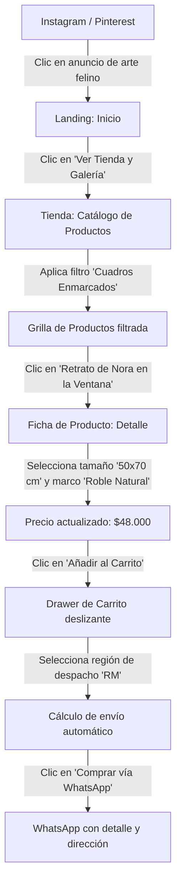
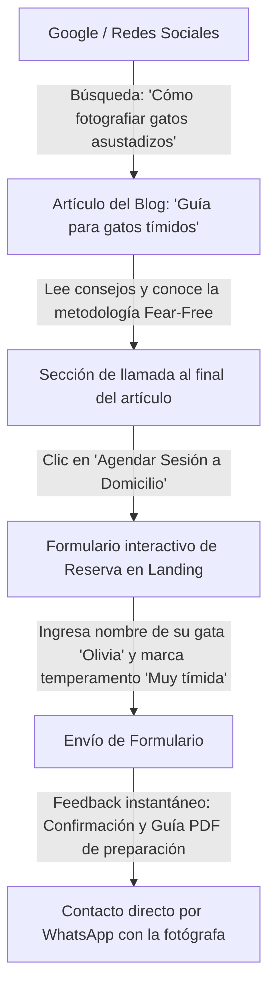

# Arquitectura de la información — Nora — Fotografía Felina

> Guía: [Arquitectura de la información](../evaluacion/guias/fase-1-requerimientos/05-arquitectura.md)

## Mapa de sitio

```text
Nora — Fotografía Felina (Sitio Web)
├── 1. Inicio (Landing Page)
│   ├── Hero principal & Manifiesto de autor
│   ├── Filosofía "Fear-Free" (Sesiones sin estrés)
│   ├── Galería destacada de la gata Nora
│   ├── Servicios de Retrato Felino (Estudio y Domicilio)
│   ├── Destacados de Tienda (Láminas Fine Art y Photobooks)
│   ├── Testimonios y Reseñas de Tutores
│   ├── Formulario de Reserva y Cotización interactivo
│   └── Newsletter con 10% de descuento
├── 2. Tienda & Galería de Arte (E-commerce)
│   ├── Barra de Búsqueda y Filtros por Categoría y Precio
│   ├── Grilla de Productos
│   │   ├── Láminas Fine Art (Papel Algodón 310g)
│   │   ├── Cuadros Enmarcados en Madera Noble
│   │   ├── Photobooks & Papelería Conmemorativa
│   │   └── Sesiones Fotográficas & Gift Cards
│   ├── Ficha de Producto (Modal / Detalle con selector de variantes)
│   └── Carrito de Compras (Slide-over drawer con WhatsApp Checkout)
├── 3. Blog Editorial
│   ├── Filtro de Categorías del Blog
│   ├── Grilla de Artículos
│   ├── Vista de Lectura de Artículo
│   │   ├── Contenido completo con imágenes de autor
│   │   ├── Caja de Autor & Productos relacionados
│   │   ├── Sistema interactivo de Comentarios
│   │   └── Botones para compartir en redes
├── 4. Páginas Institucionales y de Soporte
│   ├── Contacto & Ubicación de Estudio
│   ├── Preguntas Frecuentes (FAQ sobre sesiones y envíos)
│   ├── Términos y Condiciones
│   ├── Política de Privacidad
│   └── Página 404 (Página no encontrada con temática felina)
```

---

## User Flows

> Guía: [User flow](../evaluacion/guias/fase-1-requerimientos/06-user-flow.md)

### Flujo 1: Compra de Cuadro Fine Art para Decoración (Proto-persona: Valentina)



---

### Flujo 2: Lectura de Blog hacia Reserva de Sesión Fotográfica (Proto-persona: Valentina con gata tímida)



---

## Categorías

> Guía: [Categorías de productos y temas del blog](../evaluacion/guias/fase-1-requerimientos/07-categorias.md)

### Categorías de productos

| Categoría | Descripción orientada al cliente | Productos destacados incluidos |
|---|---|---|
| **Láminas Fine Art** | Impresiones de autor en papel de algodón Hahnemühle de 310g con tintas de museo, listas para enmarcar. | • Lámina "Nora en su Rincón Dorado" (A4 / A3)<br>• Lámina "Mirada Felina Monocromática"<br>• Set de 3 Láminas Botánicas con Gatos |
| **Cuadros Enmarcados** | Fotografías enmarcadas artesanalmente con marco de madera maciza (roble, negro o nogal) y vidrio antirreflejo. | • Cuadro "Nora Editorial en Ventana de Tarde"<br>• Cuadro "La Calma de Nora" con Paspartú de conservación |
| **Photobooks & Papelería** | Libros fotográficos de tapa dura y juegos de papelería de colección para tutores de gatos. | • Photobook de Colección "Nora & Amigos" (100 págs)<br>• Calendario de Escritorio 2027<br>• Pack de 6 Postales Fotográficas |
| **Sesiones & Gift Cards** | Paquetes de experiencia fotográfica profesional en estudio o a domicilio, y vales de regalo digitales. | • Sesión "Retrato Esencial" (1 h estudio)<br>• Sesión "Hogar Dulce Hogar" (2 h domicilio)<br>• Gift Card Digital Canjeable para Sesión |

---

### Categorías del blog

| Categoría | Idea de artículo | Necesidad o motivación de la proto-persona | Producto relacionado |
|---|---|---|---|
| **Bienestar y Metodología Fear-Free** | *"Cómo lograr que un gato tímido disfrute una sesión de fotos sin estrés ni forzarlo"* | Valentina necesita la certeza de que su gata asustadiza no sufrirá durante la toma fotográfica. | Sesión "Hogar Dulce Hogar" a Domicilio |
| **Consejos de Fotografía y Luz en Casa** | *"5 trucos de iluminación natural para fotografiar a tu gato con el móvil como un profesional"* | Deseo de capturar mejores fotos cotidianas de sus mascotas sin usar el flash directo que los asusta. | Pack de Postales y Guía Fotográfica |
| **Decoración y Arte Felino** | *"Cómo integrar cuadros de tus mascotas en una decoración nórdica y contemporánea"* | Valentina es diseñadora y busca que el homenaje a sus felinos se vea elegante y de alta gama en su salón. | Cuadro Enmarcado "Nora en la Ventana" |
