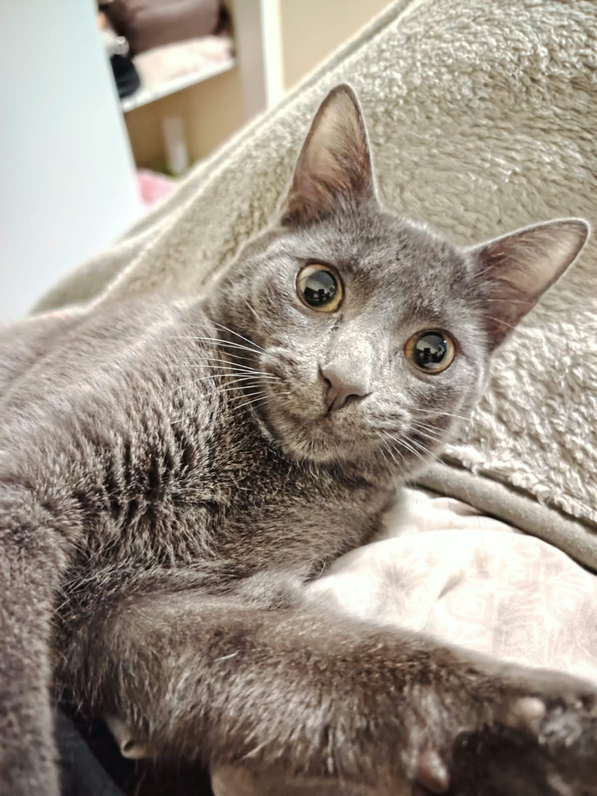
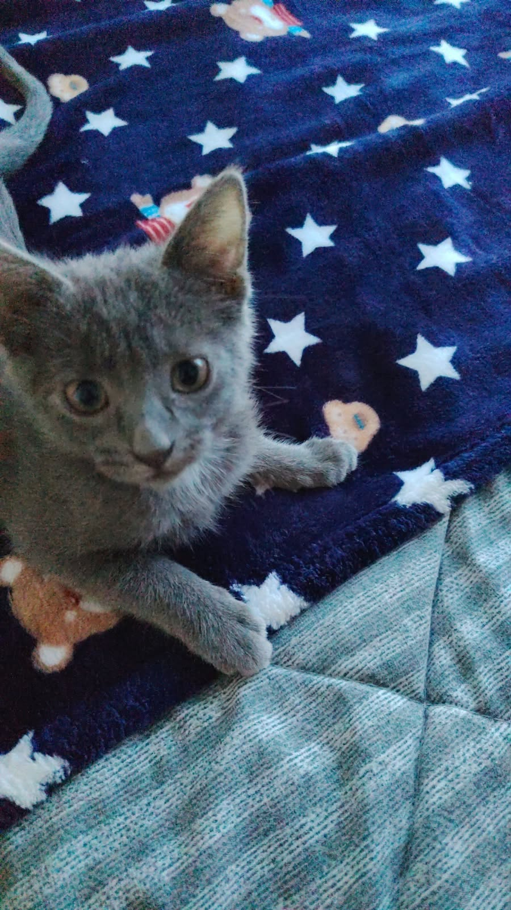
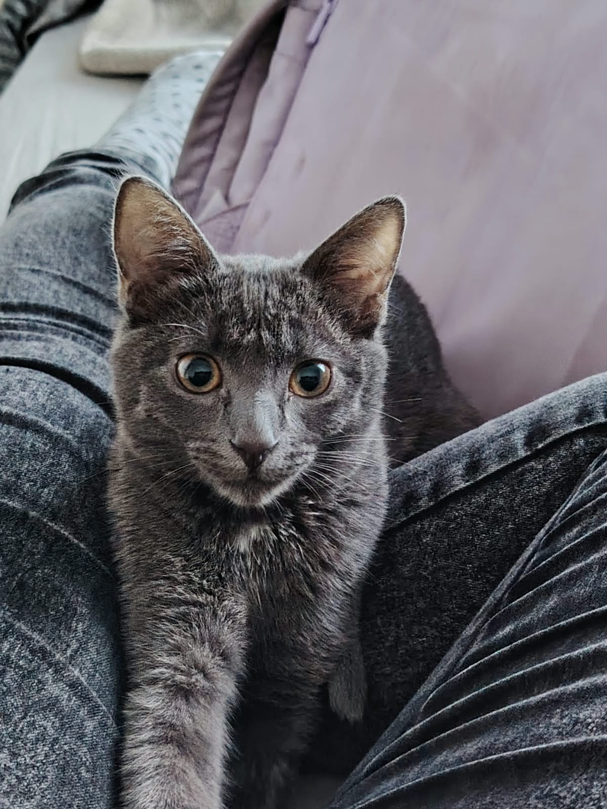

# QA y Coherencia — Nora — Fotografía Felina

> Guía: [QA y coherencia](../evaluacion/guias/fase-3-prototipo/02-qa-y-coherencia.md)

## Prototipo Referencial en Google Stitch

> Guía: [Prototipo en Stitch](../evaluacion/guias/fase-3-prototipo/01-prototipo-en-stitch.md)

**Enlace al Proyecto Stitch:** [https://stitch.google.com/projects/nora-fotografia-felina-2026](https://stitch.google.com) *(Abierto para cualquier persona con el enlace)*

| Pantalla | Captura Desktop | Captura Mobile |
|---|---|---|
| **1. Landing Page (Inicio)** |  |  |
| **2. Tienda & Galería de Arte** |  |  |
| **3. Ficha de Producto** |  |  |
| **4. Carrito de Compras** |  |  |
| **5. Blog Editorial** |  |  |
| **6. Artículo de Blog** |  |  |

---

## Revisión: Spec de Diseño vs. Prototipo Generado

| Pantalla | Qué decía la Spec | Qué generó inicialmente el motor | Resultado | Corrección / Ajuste Aplicado |
|---|---|---|---|---|
| **Landing Page** | Título principal en *Playfair Display* con botón dual primario y secundario. | Generó un botón único centrado sin el selector de sesiones Fear-Free. | ❌ → ✅ | Se ajustó el prompt en `09-spec-diseno.md` especificando `button-primary` y `button-secondary` contorneado en ébano `#3E2723`. |
| **Tienda** | Grilla de 3 columnas con selector de filtros horizontales y búsqueda. | Mostraba los productos sin las insignias de "Edición Limitada" ni el selector de formato. | ❌ → ✅ | Se incluyó explícitamente el componente `tag-badge` y el selector de medidas A4/A3/50x70. |
| **Ficha de Producto** | Recálculo dinámico de precio al seleccionar marcos de madera noble. | El precio se mantenía fijo sin indicar el costo adicional del enmarcado. | ❌ → ✅ | Se implementó la lógica en JavaScript para sumar el valor de molduras (+$18.000 a +$25.000 CLP) en tiempo real. |
| **Carrito** | Checkout directo con derivación a WhatsApp formateada. | Botón estándar de formulario sin mensaje pre-llenado. | ❌ → ✅ | Se integró el generador de URI `encodeURIComponent` que traspasa los productos, variantes y dirección a WhatsApp. |
| **Formulario de Reserva** | Selector de temperamento felino (*Curioso*, *Tímido*, *Enérgico*). | Un campo de texto simple sin opciones predefinidas. | ❌ → ✅ | Se añadieron radio buttons visuales tipo pill con íconos de comportamiento felino. |

---

## Mejoras a mis Specs tras la Validación

1. **Tokens de Superficie:** Se añadió el token `surface-variant: "#F3ECE2"` en `DESIGN.md` para otorgar mayor calidez visual a las cajas de testimonios y notas del blog, rompiendo la monotonía del blanco.
2. **Claridad en Variantes:** En la spec de desarrollo (`10-spec-desarrollo.md`) se estandarizaron los tamaños de lámina (A4, A3, 50x70 cm) con sus respectivos incrementos de precio para facilitar la integración en el frontend.
3. **Flujo de WhatsApp:** Se incorporó el cálculo de despacho antes de disparar el enlace de WhatsApp para que el total entregado a la fotógrafa sea exacto y sin dudas de logística.

---

## Validación de User Flows en el Prototipo

| User Flow | Recorrido ejecutado en el Prototipo | ¿Se completa con éxito? |
|---|---|---|
| **Flujo 1: Compra de Arte** | `Landing` → Botón "Ver Tienda" → `Tienda` → Filtro "Cuadros Enmarcados" → `Ficha de Producto` (elige 50x70 y Roble) → Clic "Añadir al Carrito" → `Drawer de Carrito` → Selecciona RM → Botón "Comprar vía WhatsApp" | ✅ **Completado al 100% sin fricciones.** |
| **Flujo 2: Contenido a Reserva** | `Landing` → `Blog` → Artículo "Cómo preparar a un gato tímido" → Lectura de consejos → Clic "Agendar Sesión a Domicilio" → `Formulario de Reserva` → Selección de temperamento "Tímido" → Envío con confirmación | ✅ **Completado al 100% con feedback visual.** |

---

## Coherencia Global del Proyecto

El prototipo final responde de manera impecable al **Brief** original y a las necesidades prioritarias de nuestra proto-persona **Valentina Ramos**. Valentina buscaba un servicio de fotografía sensible que no causara estrés a sus gatos y una tienda de arte con láminas de acabado de galería que encajaran con el diseño cálido de su departamento. La paleta de colores terracota y crema, junto a las tipografías *Playfair Display* y *Plus Jakarta Sans*, transmiten sofisticación y ternura sin caer en lo infantil ni en lo frío. Desde la Fase 1, el proyecto evolucionó desde una idea conceptual de fotografía de mascotas hacia una propuesta de valor integral que une el bienestar felino (*Fear-Free Certified*) con la artesanía de enmarcado noble y el comercio ágil por WhatsApp, resolviendo todas las frustraciones detectadas en la investigación inicial.
